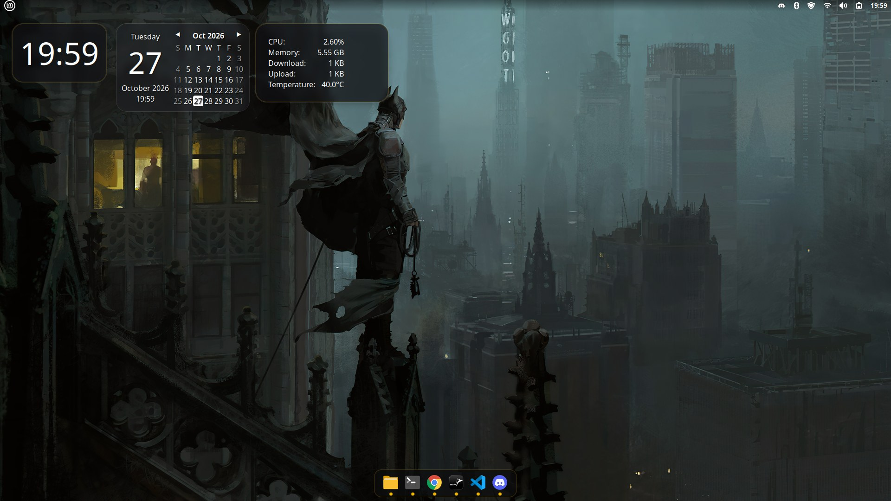

# linux-setup

Recria meu ambiente **Linux Mint 22.3 (Cinnamon)** numa instalação nova, com visual de macOS nas cores do Batman.



## Instalar o Mint do zero

**Download direto:** [linuxmint-22.3-cinnamon-64bit.iso](https://mirrors.edge.kernel.org/linuxmint/stable/22.3/linuxmint-22.3-cinnamon-64bit.iso) (3,1 GB, espelho oficial do kernel.org)
SHA-256: `a081ab202cfda17f6924128dbd2de8b63518ac0531bcfe3f1a1b88097c459bd4`

A ISO não fica no repo (são 3 GB; o GitHub aceita até 100 MB por arquivo). O [`iso.sh`](iso.sh) baixa a oficial do **Mint 22.3 Cinnamon**, confere a assinatura e o SHA-256 e, se quiser, grava no pendrive:

```bash
./iso.sh             # baixa e confere em ~/Downloads
./iso.sh /dev/sdX    # ...e grava no pendrive (apaga tudo nele; pede confirmação)
```

Sem Linux à mão: baixar em [linuxmint.com/download.php](https://linuxmint.com/download.php) e gravar com o [Balena Etcher](https://etcher.balena.io) ou o [Rufus](https://rufus.ie). Depois de instalar, seguir o **Uso** abaixo.

## Uso

```bash
sudo apt install -y git
git clone https://github.com/Longhin08/linux-setup.git
cd linux-setup
./install.sh
```

Depois: logout/login (grupo `docker` + tema), `gh auth login` e `claude` para logar.

Dá pra rodar só algumas etapas:

```bash
./install.sh apt dev
```

Os scripts podem ser rodados de novo sem problema; o que já está instalado é pulado.

## Etapas

| Etapa      | O que faz |
|------------|-----------|
| `apt`      | `apt upgrade` + pacotes de [`packages.txt`](packages.txt): git, gh, jq, tmux, zsh, build-essential, Python (pip/venv/dev), codecs, rede (arp-scan, whois, dnsutils) |
| `zram`     | Swap comprimido na RAM ([zram](https://docs.kernel.org/admin-guide/blockdev/zram.html), zstd, metade da RAM) na frente do swap em disco, para as janelas não travarem quando a memória aperta |
| `repos`    | VS Code, Docker (+ compose/buildx, usuário no grupo `docker`), AnyDesk, Google Chrome (navegador padrão; remove o Firefox), Discord |
| `dev`      | nvm + Node 24, Claude Code, OpenCode, Orca (AppImage + atalho no menu) |
| `vscode`   | Extensões de [`vscode-extensions.txt`](vscode-extensions.txt) |
| `desktop`  | Base do Cinnamon: gestos do touchpad, teclado `br+thinkpad`, sons desligados, monitores sempre na taxa de atualização máxima (`max-refresh`, no login e ao plugar um monitor) |
| `macos`    | Visual de macOS: tema [WhiteSur](https://github.com/vinceliuice/WhiteSur-gtk-theme) escuro (apps, bordas com botões 🟡🟢🔴 à direita e Cinnamon), ícones Papirus com pastas azuis, cursor Bibata, fonte Inter, wallpapers escuros do macOS, barra em cima fina e transparente, dock [Plank Reloaded](https://github.com/zquestz/plank-reloaded) com prévia das janelas, widgets (relógio, calendário, monitor) com vidro desfocado, busca [Ulauncher](https://ulauncher.io) no Super+Espaço, gestos de 3/4 dedos, prints Super+Shift+3/4/5 e luz noturna |
| `terminal` | gnome-terminal com as cores da Apple no modo escuro, fonte MesloLGS Nerd Font e prompt [Starship](https://starship.rs) |
| `batman`   | Cores do Batman por cima do visual de macOS: tema WhiteSur com destaque amarelo (texto preto em cima), pastas Papirus amarelas, dock e widgets pretos com amarelo, terminal e prompt nas mesmas cores, 8 wallpapers escuros do Batman e do Homem de Ferro ([wallhaven](https://wallhaven.cc)) |
| `dotfiles` | `.bashrc` (PATH, nvm, opencode), git (nome/e-mail + credencial do gh), statusline e atalhos do Claude Code |

## Atualizar o repo com o estado atual da máquina

```bash
dconf dump /org/cinnamon/ > dotfiles/cinnamon/cinnamon.dconf   # base (etapa desktop)
code --list-extensions > vscode-extensions.txt
cp ~/.claude/statusline.sh ~/.claude/keybindings.json dotfiles/claude/
```

O visual de macOS fica em [`dotfiles/macos/macos.dconf`](dotfiles/macos/macos.dconf) (só as chaves que ele muda); ajustar à mão.

Pacotes apt novos: adicionar em `packages.txt`.

## Visual de macOS: detalhes

- **Cor das pastas**: `papirus-folder-color orange` (ou `red`, `green`...) e escolher `Papirus-Dark-<Cor>` em Temas → Ícones.
- **Widgets**: a extensão `widget-blur@local` usa como fundo um pedaço borrado do wallpaper; acompanha quando o widget é arrastado ou o wallpaper muda.
- **Dock**: Ctrl + clique direito no dock abre as preferências do Plank.

## Visual Batman: detalhes

- **Wallpaper**: ficam em `~/.local/share/backgrounds/batman` (aparecem em Configurações → Plano de fundo); o padrão é o Batman no telhado de Gotham. Para trocar a lista, editar os caminhos `w.wallhaven.cc/full/...` em `scripts/batman.sh`.
- **Tema**: `dotfiles/batman/recolor-theme.py` copia o `WhiteSur-Dark` para `WhiteSur-Dark-Batman` trocando todo azul por amarelo; para outra cor, mudar `HUE` no script.
- **Voltar ao macOS azul**: `./install.sh macos terminal`.

## Voltar ao visual padrão do Mint

```bash
dconf load /org/cinnamon/ < dotfiles/cinnamon/cinnamon.dconf
gsettings set org.cinnamon.desktop.wm.preferences button-layout ':minimize,maximize,close'
gsettings set org.cinnamon panels-enabled "['1:0:bottom']"
pkill plank; rm ~/.config/autostart/plank.desktop
```
